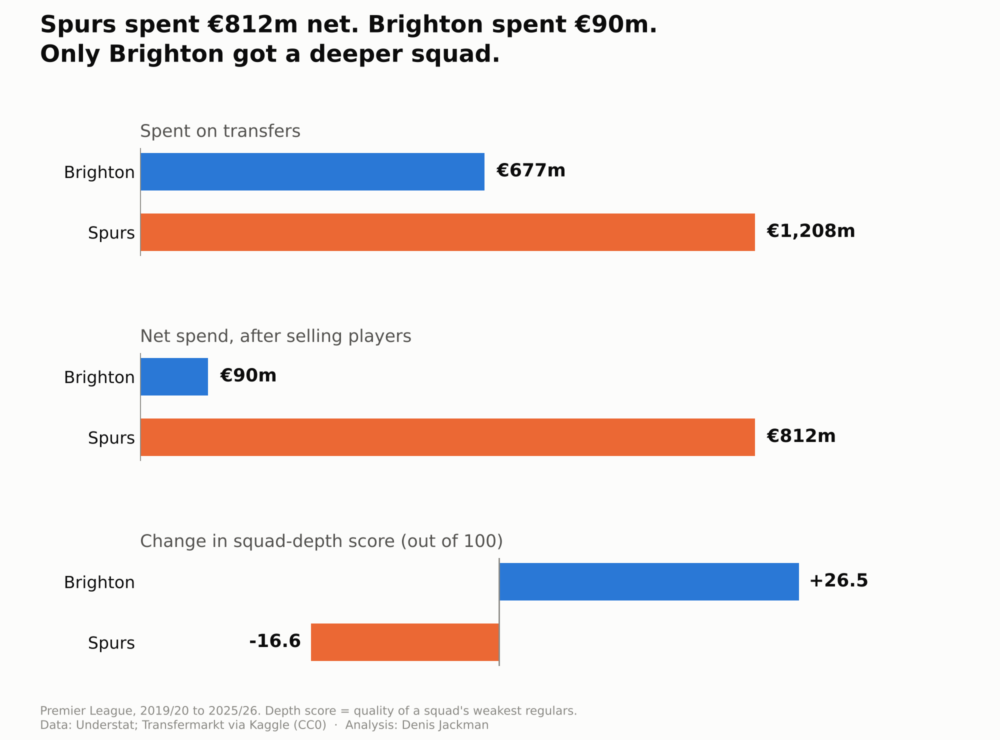
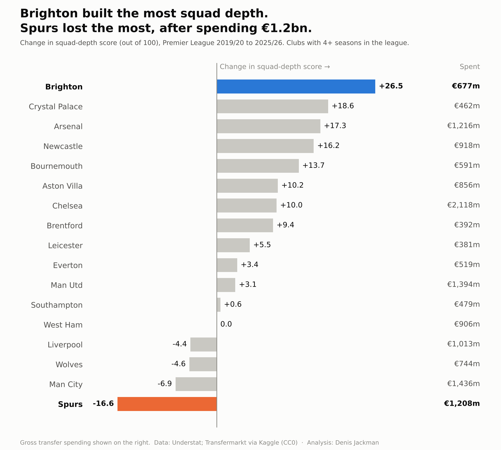

# Can you buy squad depth? Brighton vs Spurs, 2019/20–2025/26

Brighton spent €90m net on transfers over seven Premier League seasons and improved its squad depth more than any other club. Spurs spent €812m net and lost the most. This project measures why.



## The measure

**Squad depth** is the quality of a squad's weakest regulars: the 20th-percentile player among those with 900+ league minutes, rated by position from per-90 npxG, xA, xGChain and xGBuildup against a replacement-level player. Shown here as a score out of 100.

It comes from my UCD economics thesis. In an earlier project ([squad-depth-football](https://github.com/denisjackman00-hub/squad-depth-football)) I showed that since 2022/23 depth predicts Premier League points better than a squad's top three players do.

## Findings

1. **Spending didn't buy depth.** Across 119 club-seasons, each extra €100m of transfer spend added +0.006 to depth (95% range −0.017 to +0.029), even after allowing for each club's starting depth. A typical club's depth moves by about 0.09 in a season, so €100m buys at most a third of that.
2. **Brighton** spent €677m (€90m net) and gained +26.5, the most of any club. They still beat expectations after allowing for their low starting point.
3. **Spurs** spent €1.2bn (€812m net) and lost −16.6, the most of any club in the league all seven seasons.
4. **Depth comes mostly through the exit door.** Across the league, moving on weak regulars added more depth than new signings did. For Brighton, Aston Villa and Newcastle, 83% of their depth gain came through the transfer market.
5. **The elite clubs' money bought stability.** Squads that start very deep usually slide back. City, Arsenal, Liverpool and Chelsea didn't, so all four beat expectations.



Main tests were written down before looking at the results. These are associations in observational data, not proof of cause.

**Caveats:** undisclosed fees count as zero, loans and free transfers have no fee, and wages are not included.

## Files

| File | What it does |
|---|---|
| `loaders/understat.py`, `loaders/understat_teams.py` | Download Premier League player and team data from Understat |
| `depth_sources.py` | Splits each club's depth change into signings, departures, players improving and players promoted from within |
| `depth_per_euro.py` | Depth gained per euro spent, club by club |
| `ceiling_test.py` | Does spending buy depth once starting depth is allowed for? |

## Run it

```
py -m pip install understatapi pandas numpy
py -m loaders.understat --from 2014 --to 2025
py -m loaders.understat_teams --from 2014 --to 2025
py depth_per_euro.py
py ceiling_test.py
```

Transfer fees: Transfermarkt, via the player-scores dataset on Kaggle (CC0). Download it and unzip into `data/raw/transfermarkt`. Raw data is not included in this repository.

Denis Jackman, economics graduate (UCD). Feedback welcome.
